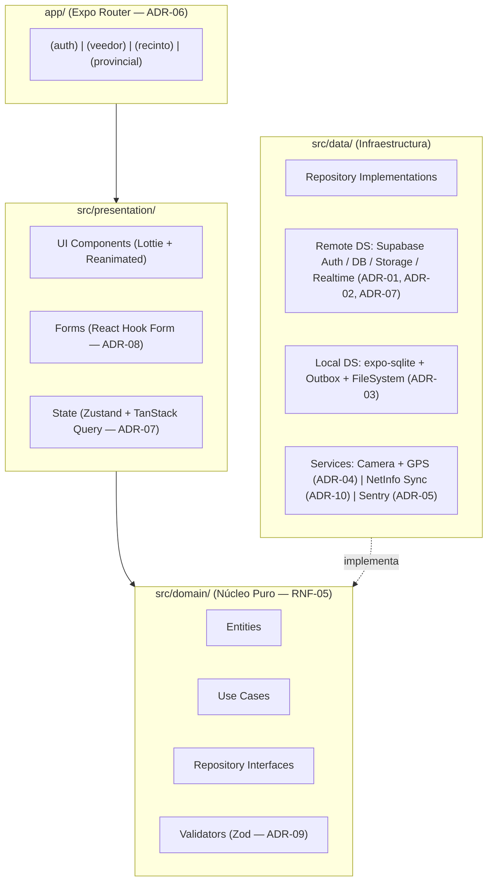
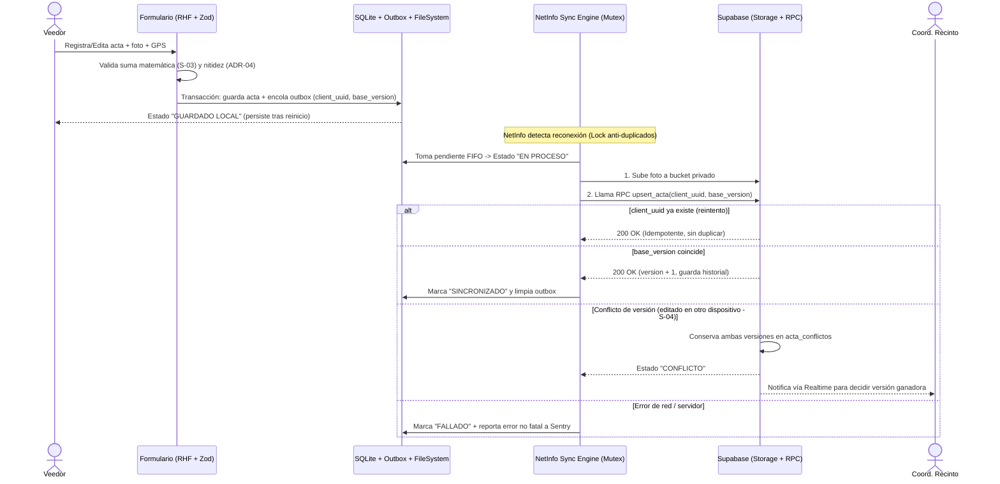

# Arquitectura de Software — Control Electoral Móvil

## 1. Propósito y Línea Base

Este documento define la arquitectura de software de la aplicación móvil de **Control Electoral para Organización Política**, desarrollada en React Native (Expo) con entrega en formato APK instalable para Android (**RNF-01**).

Toda la estructura aquí descrita respeta de forma estricta la línea base consensuada por el equipo:
- **20 Requerimientos Funcionales (RF-01 a RF-20)**
- **8 Requerimientos No Funcionales (RNF-01 a RNF-08)**
- **6 Supuestos Adoptados (S-01 a S-06)**
- **10 Registros de Decisiones Arquitectónicas (ADR-01 a ADR-10)**

---

## 2. Estilo Arquitectónico: Clean Architecture + Expo Router

Para garantizar mantenibilidad, testabilidad y facilidad de evolución (**RNF-05**), el proyecto implementa **Clean Architecture** organizada en tres capas concéntricas con inversión de dependencias, desacoplada del sistema de enrutamiento basado en archivos de **Expo Router (ADR-06)**.

### Regla de Dependencias
Las dependencias apuntan **siempre hacia adentro** (hacia `src/domain/`):
- **`app/` (Enrutamiento):** Solo define pantallas, layouts y guardas de navegación. Nunca contiene lógica de negocio ni acceso directo a SQLite o Supabase.
- **`src/presentation/` (Presentación):** Componentes visuales, tema institucional, formularios (React Hook Form), estado global (Zustand) y caché remota (TanStack Query). Invoca **exclusivamente** casos de uso de `src/domain/`.
- **`src/domain/` (Dominio — Núcleo puro):** Entidades, contratos/interfaces de repositorio, casos de uso y esquemas de validación (Zod). **No depende** de React, Expo, Supabase ni SQLite.
- **`src/data/` (Datos e Infraestructura):** Implementaciones concretas de los repositorios del dominio, fuentes de datos remotas (Supabase Auth, PostgreSQL, Storage, Realtime, Edge Functions), persistencia local (SQLite + FileSystem) y servicios nativos (Cámara, GPS, NetInfo, Sentry).



---

## 3. Estructura de Carpetas

Por restricción de **ADR-06**, todo archivo dentro de `app/` es interpretado como una ruta por Expo Router; por ello, las capas de Clean Architecture residen completamente fuera de `app/`, dentro de `src/`.

```text
.
├── docs/
│   ├── arquitectura.md               # Este documento (RNF-08)
│   └── adr/                          # Fichas ADR-01 a ADR-10
├── app/                              # Solo rutas de Expo Router (ADR-06)
│   ├── _layout.tsx                   # Providers + Guard (sesión, rol, cambio de clave)
│   ├── index.tsx                     # Splash y redirección inicial
│   ├── (auth)/                       # Login, primer ingreso obligatorio, recuperación
│   ├── (veedor)/                     # Mesas asignadas, formulario de acta, cola offline
│   ├── (recinto)/                    # Gestión de veedores, reasignación, actas y conflictos
│   └── (provincial)/                 # Exit Poll en vivo, recintos, coordinadores, auditoría GPS
├── src/
│   ├── domain/                       # Capa de Dominio (TypeScript puro)
│   │   ├── entities/                 # User, Recinto, Mesa, Partido, Candidato, Acta, Conflicto
│   │   ├── repositories/             # Interfaces: AuthRepo, TerritorioRepo, ActaRepo, SyncRepo
│   │   ├── usecases/                 # Casos de uso atómicos por requerimiento
│   │   ├── validators/               # Esquemas Zod: cédula ecuatoriana, correo y actas (ADR-09)
│   │   └── utils/                    # Cálculo Haversine para alerta >300m (S-06)
│   ├── data/                         # Capa de Datos e Infraestructura
│   │   ├── datasources/
│   │   │   ├── remote/               # Cliente Supabase, Edge Functions, Realtime, Storage
│   │   │   └── local/                # SQLite, migraciones, tabla outbox, almacenamiento de fotos
│   │   ├── repositories/             # Implementaciones que unen local + remoto
│   │   └── services/                 # NetInfo Sync Engine, Sharpness Check, GPS Burst, Sentry
│   ├── presentation/                 # Capa de Presentación
│   │   ├── theme/                    # Paleta de la organización política y accesibilidad (RNF-06/07)
│   │   ├── store/                    # Stores Zustand (auth, sync, feedback) (ADR-07)
│   │   ├── hooks/                    # Hooks de TanStack Query, Realtime y RHF (ADR-07/08)
│   │   └── components/               # Componentes accesibles, FeedbackOverlay (Lottie + Reanimated)
│   └── shared/                       # Constantes, tipos globales y utilidades transversales
└── supabase/
    ├── migrations/                   # Esquema SQL, restricciones, RPC idempotente y políticas RLS
    ├── seed.sql                      # Recintos, 5 organizaciones, candidatos y Provincial (RF-05, S-01)
    └── functions/
        └── create-managed-user/      # Creación jerárquica de cuentas sin cerrar sesión (ADR-01/02)
```

---

## 4. Trazabilidad de Decisiones Técnicas (ADRs)

| ADR | Decisión Tecnológica | Capa Principal | Requerimientos / Supuestos |
| :--- | :--- | :--- | :--- |
| **ADR-01** | **Supabase Auth + RLS + Edge Function** para gestión jerárquica de usuarios y control de clave temporal | `data/remote` + Backend | RF-01, RF-02, RF-03, RF-04, RNF-02, S-01 |
| **ADR-02** | **Supabase + SMTP personalizado** para verificación de correo y recuperación con enlaces de un solo uso | Backend (Auth/SMTP) | RF-01, RF-03, RF-04, RNF-02 |
| **ADR-03** | **SQLite (`expo-sqlite`) + tabla `outbox` + UUID por acta** como fuente de verdad offline y ruta local de foto | `data/local` | RF-14, RF-16, RNF-03, RNF-04, S-04 |
| **ADR-04** | **`expo-camera` (en vivo + nitidez) + `expo-location` (múltiples lecturas)** sin acceso a galería | `data/services` | RF-11, RF-12, RF-15, S-06 |
| **ADR-05** | **Sentry React Native SDK** con captura de cierres nativos/JS, breadcrumbs, buffer offline y filtrado PII | `data/services` + `app/` | RF-17, RNF-02, RNF-03 |
| **ADR-06** | **Expo Router** con grupos de rutas aislados por rol y redirección controlada por sesión/rol/clave | `app/` | RF-01, RF-02, RF-18, RNF-05, RNF-07 |
| **ADR-07** | **Zustand + TanStack Query + Supabase Realtime** encapsulado en repositorios | `presentation/` + `data/` | RF-14, RF-15, RF-16, RNF-05 |
| **ADR-08** | **React Hook Form** con `Controller` para formularios de usuarios, territorio y actas | `presentation/` | RF-02, RF-06, RF-08, RF-09, RF-13, RF-20, RNF-04, RNF-07, S-03 |
| **ADR-09** | **Zod** centralizado para validar cédula ecuatoriana, correos y coherencia matemática de actas | `domain/validators` | RF-02, RF-10, RF-12, RF-19, RNF-02, S-02, S-03 |
| **ADR-10** | **`@react-native-community/netinfo` + cola SQLite** con bloqueo de concurrencia e idempotencia | `data/services` + `data/local` | RF-14, RF-16, RNF-03, RNF-04, S-04 |

---

## 5. Flujos Críticos de la Arquitectura

### 5.1 Autenticación, Jerarquía de Cuentas y Control de Acceso (ADR-01, ADR-02, ADR-06)
1. **Registro público deshabilitado:** El único Coordinador Provincial existe precargado vía `seed.sql` (**S-01**).
2. **Creación delegada en servidor:** Al crear un Coordinador de Recinto o un Veedor (**RF-01**, **RF-20**), la app invoca la Edge Function `create-managed-user`. Esto evita que se cierre la sesión del coordinador y dispara el correo de verificación por **SMTP personalizado** (**RF-03**, **ADR-02**).
3. **Guardia de navegación (`app/_layout.tsx`):** Evalúa tres variables en orden estricto (**ADR-06**):
   - Sin sesión activa o correo sin verificar → `/(auth)/login`
   - Sesión activa con `must_change_password === true` → `/(auth)/primer-ingreso` (**RF-02**)
   - Sesión válida y clave definitiva → redirección al grupo de rutas del rol (`provincial`, `recinto` o `veedor`).
4. **Recuperación autónoma:** Solo disponible para correos previamente verificados, mediante enlace de un solo uso con expiración que abre la app vía *deep link* (`controlelectoral://`) (**RF-04**, **ADR-02**).

### 5.2 Persistencia Offline-First, Sincronización Idempotente y Conflictos (ADR-03, ADR-10, S-04)

Toda operación de registro o edición de actas escribe **primero en SQLite** dentro de una transacción junto con la cola `sync_outbox` y un `client_uuid` único. El archivo fotográfico se almacena localmente tras validar espacio disponible en disco y no se elimina hasta confirmar recepción en el servidor (**ADR-03**).



### 5.3 Validación de Actas, Evidencia Fotográfica y Geolocalización (ADR-04, ADR-08, ADR-09)
- **Bloqueo matemático estricto (RF-10, RF-19, S-03):** El esquema Zod en `src/domain/validators/` impide guardar si existen valores negativos, si un partido supera el total de sufragantes o si `(votos_partidos + blancos + nulos) !== total_sufragantes`.
- **Cámara en vivo y nitidez (RF-11, ADR-04):** Se captura únicamente con `expo-camera` (sin selector de galería). Antes de confirmar, se calcula la nitidez de la imagen; si está borrosa o ilegible se advierte y bloquea el avance hasta recapturar. El usuario siempre visualiza la vista previa antes de confirmar.
- **Geolocalización de mejor precisión (RF-12, S-06):** Al capturar la foto, `expo-location` toma múltiples lecturas y conserva la de menor error en metros. Las coordenadas GPS son obligatorias para guardar, pero no se aplica bloqueo por geocerca estricta; en la auditoría del coordinador se calcula la distancia con **Haversine** respecto al recinto y se muestra una **alerta visual si supera los 300 metros**.

### 5.4 Manejo de Estado y Exit Poll en Tiempo Real (ADR-07, RF-15, S-02)
- **Zustand** administra exclusivamente estado síncrono y de cliente: sesión activa, rol, estado de red (`isOnline`), progreso de sincronización (`isSyncing`, pendientes) y estado del overlay de retroalimentación visual.
- **TanStack Query** gestiona datos remotos invocando casos de uso del dominio (`recintos`, `mesas`, `actas`, `exitPoll`).
- **Supabase Realtime** se encapsula dentro de `src/data/datasources/remote/realtimeDS.ts` y se expone mediante contratos de repositorio para no romper Clean Architecture. Al recibir un `INSERT`/`UPDATE` en `actas` o `mesas`, invalida selectivamente las queries del conteo rápido y del avance por recinto (considerando una mesa **completa** únicamente al recibir Alcaldía y Prefectura, o **parcial** con una sola, según **S-02**). Las suscripciones se cierran obligatoriamente al cerrar sesión.

---

## 6. Seguridad, Confidencialidad y Monitoreo

### 6.1 Aislamiento de Datos por Rol (RF-18, RNF-02, S-05)
El control de acceso se aplica en **doble capa**: navegación en la app (**ADR-06**) y **Row Level Security (RLS)** en PostgreSQL (**ADR-01**):
- **Veedor:** Lectura/escritura únicamente sobre mesas donde `veedor_id = auth.uid()` y sus actas. Al ser reemplazado por el coordinador de recinto (**RF-20**, **S-05**), el cambio de `veedor_id` revoca su acceso al instante en RLS, mientras las actas ya registradas permanecen intactas en `actas` y `acta_historial`.
- **Coordinador de Recinto:** Acceso total exclusivamente a mesas, veedores, actas y conflictos de su `recinto_id` (restricción `UNIQUE` en `recintos.coordinador_id` garantiza un solo coordinador por recinto, **RF-07**).
- **Coordinador Provincial:** Acceso de lectura a toda su jurisdicción, gestión de recintos y creación de coordinadores de recinto.

### 6.2 Protección de Credenciales y Telemetría de Errores (RF-17, RNF-02, RNF-03, ADR-05)
- Los tokens de sesión se almacenan cifrados mediante `expo-secure-store`.
- Las credenciales SMTP y llaves administrativas (`service_role_key`) viven exclusivamente en el backend de Supabase.
- **Sentry** captura automáticamente cierres nativos (en Development Build / APK), excepciones de JavaScript, errores no fatales (ej. fallo de subida de foto o sincronización), breadcrumbs de pantallas, modelo de dispositivo y versión de Android, almacenando eventos en caché cuando no hay internet.
- Un interceptor `beforeSend` en `sentryService.ts` elimina **PII** (cédulas de 10 dígitos, nombres, teléfonos y correos) antes de que cualquier reporte salga del dispositivo (**ADR-05**).

---

## 7. Lineamientos de Diseño e Interfaz (RNF-06, RNF-07)

- **Identidad visual:** Sistema de tokens en `src/presentation/theme/` basado en los colores de la organización política elegida, aplicado de forma consistente en encabezados, tarjetas, gráficos del Exit Poll y distintivos de dignidad.
- **Retroalimentación visual sin modales genéricos:** Queda prohibido el uso de `Alert.alert` nativos. Todos los estados (`en proceso`, `guardado`, `sincronizado`, `fallado`, `conflicto` y validaciones) utilizan un sistema unificado de overlays, banners y bottom sheets animados con **Lottie** y **React Native Reanimated**.
- **UX accesible (RNF-07):** Áreas táctiles amplias (mínimo `52px`), tipografía legible de alto contraste, teclado numérico dedicado en transcripción de actas, confirmación visual previa al envío y protección contra doble pulsación en botones de guardado.

---

## 8. Estrategia de Empaquetado y Entrega (RNF-01)

- Compilación nativa mediante **EAS Build** (`eas.json`, perfil `preview` con `buildType: "apk"`) para obtener el archivo `.apk` instalable en dispositivos Android físicos.
- El *scheme* de *deep linking* (`controlelectoral://`) se configura de forma idéntica en `app.json` y en Supabase Redirect URLs para garantizar que los enlaces de confirmación y recuperación funcionen tanto en pruebas como en el APK final (**ADR-02**).
- Las pruebas de captura de cierres nativos de **Sentry** (**ADR-05**) y de persistencia tras reinicio en **SQLite** (**ADR-03**) se validan directamente sobre el APK instalado.