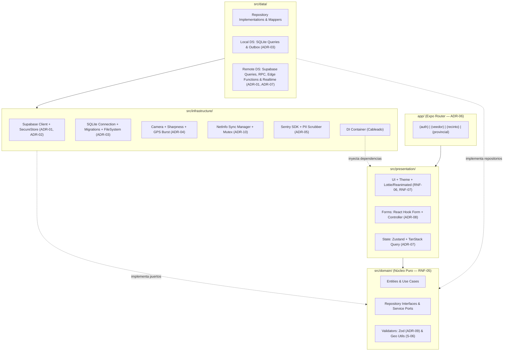
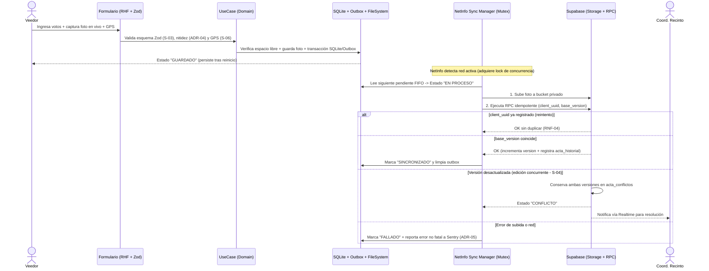

# Arquitectura de Software — Control Electoral Móvil

## 1. Propósito y Línea Base del Proyecto

Este documento define la arquitectura de software de la aplicación móvil de **Control Electoral para Organización Política**, desarrollada en React Native (Expo) y distribuida como archivo **APK instalable para Android** (**RNF-01**).

Su elaboración precede a la instalación de dependencias y codificación (**RNF-08**) y garantiza el cumplimiento estricto e íntegro de la línea base consensuada por el equipo:
- **20 Requerimientos Funcionales:** `RF-01` a `RF-20`
- **8 Requerimientos No Funcionales:** `RNF-01` a `RNF-08`
- **6 Supuestos Adoptados:** `S-01` a `S-06`
- **10 Decisiones Arquitectónicas:** `ADR-01` a `ADR-10`

---

## 2. Estilo Arquitectónico: Clean Architecture (4 Capas) + Expo Router

Para facilitar el mantenimiento, la corrección de errores y la evolución del sistema (**RNF-05**), el proyecto adopta **Clean Architecture** con separación estricta en cuatro capas dentro de `src/`, desacopladas del sistema de enrutamiento basado en archivos de **Expo Router** en `app/` (**ADR-06**).

### Regla de Dependencias
Las dependencias apuntan **siempre hacia el núcleo (`src/domain/`)**:

1. **`app/` (Enrutamiento — ADR-06):** Contiene exclusivamente rutas, layouts y la guardia de redirección inicial. No aloja lógica de negocio, validaciones ni acceso directo a bases de datos o SDKs.
2. **`src/presentation/` (Presentación):** Interfaces accesibles (**RNF-07**), identidad visual del partido y animaciones con Lottie + Reanimated (**RNF-06**), formularios con React Hook Form (**ADR-08**), estado de cliente en Zustand y caché remota con TanStack Query (**ADR-07**). Solo interactúa con `src/domain/` mediante casos de uso.
3. **`src/domain/` (Dominio — Núcleo Puro):** Entidades del negocio, contratos de repositorios, puertos de servicios nativos, casos de uso, lógica geográfica (Haversine) y esquemas de validación con Zod (**ADR-09**). **Cero dependencias** de React, Expo, Supabase, SQLite o UI.
4. **`src/data/` (Datos):** Implementaciones concretas de los repositorios del dominio, mappers (DTO ↔ Entidad) y *datasources* encargados de consultas relacionales en SQLite/Outbox (**ADR-03**) y consumo de tablas, RPCs, Storage, Edge Functions y Realtime de Supabase (**ADR-01**, **ADR-07**).
5. **`src/infrastructure/` (Infraestructura — Frameworks & Drivers):** Adaptadores de hardware, red, almacenamiento y SDKs externos (cliente Supabase + SecureStore, motor SQLite y migraciones, FileSystem con control de almacenamiento, Expo Camera + análisis de nitidez, Expo Location con muestreo GPS, NetInfo Sync Manager con control de concurrencia, Sentry con filtrado PII y contenedor de inyección de dependencias).



---

## 3. Estructura de Carpetas del Repositorio

En cumplimiento de **ADR-06**, todo código de arquitectura y componentes reutilizables se ubica fuera de `app/` para que Expo Router no lo interprete como rutas.

```text
.
├── docs/
│   ├── arquitectura.md                     # Documentación arquitectónica (RNF-08)
│   └── adr/                                # ADR-01.md a ADR-10.md
├── app/                                    # Solo rutas de Expo Router (ADR-06)
│   ├── _layout.tsx                         # Sentry, QueryClient, NetInfo y Guard de sesión/rol/clave
│   ├── index.tsx                           # Pantalla inicial de evaluación y redirección
│   ├── (auth)/
│   │   ├── _layout.tsx
│   │   ├── login.tsx                       # Acceso restringido (sin registro público)
│   │   ├── primer-ingreso.tsx              # Cambio obligatorio de clave temporal (RF-02)
│   │   ├── recuperar-clave.tsx             # Solicitud de enlace solo a correos verificados (RF-04)
│   │   └── nueva-clave.tsx                 # Destino de deep link de recuperación (ADR-02)
│   ├── (veedor)/
│   │   ├── _layout.tsx
│   │   ├── index.tsx                       # Mis mesas asignadas y estado de actas (RF-14, RF-18)
│   │   ├── mesa/[mesaId].tsx               # Selección Alcaldía / Prefectura (RF-09, S-02)
│   │   ├── acta-form.tsx                   # Registro/corrección + cámara + GPS (RF-09 a RF-13, RF-19)
│   │   └── cola-sync.tsx                   # Detalle de cola offline y estados (RF-14, RF-16)
│   ├── (recinto)/
│   │   ├── _layout.tsx
│   │   ├── index.tsx                       # Panel del recinto y alertas de conflicto (RF-18, S-04)
│   │   ├── mesas.tsx                       # Asignación y reasignación instantánea (RF-08, RF-20, S-05)
│   │   ├── veedores.tsx                    # Registro de veedores y sustituto express (RF-01, RF-20)
│   │   ├── actas.tsx                       # Consulta y edición de actas del recinto (RF-13)
│   │   └── conflictos.tsx                  # Comparación y resolución de versiones (S-04)
│   └── (provincial)/
│       ├── _layout.tsx
│       ├── index.tsx                       # Tablero Exit Poll en tiempo real y avance (RF-15, ADR-07)
│       ├── recintos.tsx                    # Consulta, creación y asignación única de coord. (RF-06, RF-07)
│       ├── coordinadores.tsx               # Gestión y creación de coord. de recinto (RF-01, RF-02)
│       └── acta-auditoria/[id].tsx         # Evidencia fotográfica + mapa GPS con alerta >300m (S-06)
├── src/
│   ├── domain/                             # CAPA 1: Dominio puro
│   │   ├── entities/                       # User, Recinto, Mesa, Organizacion, Candidato, Acta, Conflicto, SyncItem
│   │   ├── repositories/                   # IAuthRepository, ITerritorioRepository, IActaRepository, IEscrutinioRepository, ISyncRepository
│   │   ├── ports/                          # ILocationPort, ISharpnessPort, IFileStoragePort, INetworkMonitorPort, ICrashMonitorPort
│   │   ├── usecases/                       # Casos de uso atómicos (auth/, territorio/, actas/, escrutinio/, sync/)
│   │   ├── validators/                     # Esquemas Zod: cedulaEcuador.ts, userSchema.ts, actaSchema.ts (ADR-09)
│   │   └── utils/                          # geoDistance.ts (Haversine y umbral 300m — S-06)
│   ├── data/                               # CAPA 2: Persistencia, mappers y repositorios
│   │   ├── datasources/
│   │   │   ├── local/                      # actaLocalDS.ts, outboxLocalDS.ts, catalogLocalDS.ts (ADR-03)
│   │   │   └── remote/                     # authRemoteDS.ts, territorioRemoteDS.ts, actaRemoteDS.ts, realtimeDS.ts
│   │   ├── mappers/                        # Mappers SQLite/Supabase <-> Entidades de Domain
│   │   └── repositories/                   # AuthRepositoryImpl, TerritorioRepositoryImpl, ActaRepositoryImpl, EscrutinioRepositoryImpl, SyncRepositoryImpl
│   ├── infrastructure/                     # CAPA 3: SDKs externos, hardware y DI
│   │   ├── supabase/                       # supabaseClient.ts, secureStoreAdapter.ts (ADR-01, ADR-02)
│   │   ├── sqlite/                         # dbConnection.ts, migrations.ts (ADR-03)
│   │   ├── storage/                        # fileSystemPhotoAdapter.ts (guardado local y validación de espacio)
│   │   ├── device/                         # gpsLocationAdapter.ts, sharpnessAnalyzer.ts (ADR-04)
│   │   ├── network/                        # netInfoSyncManager.ts (escucha NetInfo + lock mutex — ADR-10)
│   │   ├── monitoring/                     # sentryAdapter.ts (cierres nativos/JS, breadcrumbs, filtro PII — ADR-05)
│   │   └── di/                             # container.ts (inyección de dependencias)
│   ├── presentation/                       # CAPA 4: UI, estado y formularios
│   │   ├── theme/                          # Colores de la organización política y escalas accesibles (RNF-06/07)
│   │   ├── store/                          # Zustand: authStore.ts, syncStore.ts, feedbackStore.ts (ADR-07)
│   │   ├── hooks/                          # Hooks de TanStack Query, suscripción Realtime y formularios (ADR-07/08)
│   │   └── components/                     # FeedbackOverlay (Lottie + Reanimated), ConfirmSheet, ControlledInput, MapAuditView, StatusBadge
│   └── shared/                             # Constantes, tipos de error y utilidades transversales
├── assets/
│   └── lottie/                             # Animaciones JSON (loading, success, error, warning, syncing)
└── supabase/
    ├── migrations/                         # Esquema PostgreSQL, constraints, RPC de versionado y políticas RLS
    ├── seed.sql                            # Provincia/cantón, recintos, 5 organizaciones, candidatos y Coord. Provincial (RF-05, S-01)
    └── functions/
        └── create-managed-user/            # Edge Function para creación jerárquica de usuarios vía API (ADR-01, ADR-02)
```

---

## 4. Matriz de Trazabilidad (ADRs ↔ Capas ↔ Requerimientos)

| ADR | Decisión Consensuada | Capas Responsables | Requerimientos / Supuestos |
| :--- | :--- | :--- | :--- |
| **ADR-01** | **Supabase Auth + API servidor + RLS + flag de clave temporal** | `infrastructure/supabase`, `data/remote`, Backend | RF-01, RF-02, RF-03, RF-04, RNF-02, S-01 |
| **ADR-02** | **Supabase + SMTP personalizado** (enlaces de uso único con expiración, dominio propio, deep links) | `infrastructure/supabase`, `app/(auth)`, Backend | RF-01, RF-03, RF-04, RNF-02 |
| **ADR-03** | **SQLite (`expo-sqlite`) + Outbox + UUID por acta + foto en disco local + control de versiones** | `infrastructure/sqlite`, `infrastructure/storage`, `data/local` | RF-14, RF-16, RNF-03, RNF-04, S-04 |
| **ADR-04** | **`expo-camera` en vivo + medición de nitidez + `expo-location` con múltiples lecturas GPS** | `domain/ports`, `infrastructure/device`, `presentation/` | RF-11, RF-12, RF-15, S-06 |
| **ADR-05** | **Sentry React Native SDK** (cierres nativos/JS, breadcrumbs, buffer offline y filtrado de PII) | `domain/ports`, `infrastructure/monitoring`, `app/_layout` | RF-17, RNF-02, RNF-03 |
| **ADR-06** | **Expo Router** con grupos por rol y guardia de redirección (sesión, rol, primer cambio de clave) | `app/` | RF-01, RF-02, RF-18, RNF-05, RNF-07 |
| **ADR-07** | **Zustand + TanStack Query + Supabase Realtime** encapsulado tras repositorios | `presentation/store`, `presentation/hooks`, `data/repositories` | RF-14, RF-15, RF-16, RNF-05 |
| **ADR-08** | **React Hook Form** (`Controller`) para formularios de usuarios, territorio, reemplazos y actas | `presentation/components`, `presentation/hooks` | RF-02, RF-06, RF-08, RF-09, RF-13, RF-20, RNF-04, RNF-07, S-03 |
| **ADR-09** | **Zod** centralizado para cédula ecuatoriana, correos y coherencia matemática de actas | `domain/validators` | RF-02, RF-10, RF-12, RF-19, RNF-02, S-02, S-03 |
| **ADR-10** | **`@react-native-community/netinfo` + cola transaccional SQLite + UUID idempotente + lock** | `infrastructure/network`, `data/local`, `domain/usecases/sync` | RF-14, RF-16, RNF-03, RNF-04, S-04 |

---

## 5. Diseño de los Flujos Críticos

### 5.1 Autenticación Jerárquica, Verificación SMTP y Guardia de Rutas (ADR-01, ADR-02, ADR-06)
- **Raíz precargada (S-01):** El único Coordinador Provincial se precarga mediante `seed.sql` con correo verificado y rol `PROVINCIAL`. El registro público permanece deshabilitado en Supabase Auth.
- **Creación por terceros en servidor (RF-01, RF-20):** El Coordinador Provincial crea Coordinadores de Recinto y estos crean Veedores (incluidos veedores sustitutos externos) invocando la Edge Function `create-managed-user`. Al ejecutarse en el servidor con privilegios administrativos, **no se interrumpe la sesión del coordinador** y se dispara automáticamente el correo de verificación a través del **SMTP personalizado** (cuyas credenciales residen únicamente en Supabase, **RNF-02**).
- **Verificación y recuperación (RF-03, RF-04):** El titular confirma su correo mediante enlace único con expiración antes de poder ingresar. La recuperación de contraseña solo se habilita para correos previamente verificados y redirige a la app usando el esquema de *deep link* configurado de forma idéntica en desarrollo y en el APK (`controlelectoral://`).
- **Redirección inicial en `app/_layout.tsx` (ADR-06):** Evalúa secuencialmente:
  1. `¿Existe sesión válida con correo verificado?` → Si no, redirige a `/(auth)/login`.
  2. `¿must_change_password === true en metadatos/perfil?` → Si sí, obliga a pasar por `/(auth)/primer-ingreso` (**RF-02**).
  3. `¿Rol activo?` → Redirige al grupo exclusivo `/(provincial)`, `/(recinto)` o `/(veedor)`.

### 5.2 Persistencia Offline-First, Sincronización Automática y Conflictos (ADR-03, ADR-10, S-04)
- **Fuente de verdad local:** Toda creación o edición de acta se persiste en una transacción de `expo-sqlite` (`local_actas` + `sync_outbox`) con un `client_uuid` único y su número de versión (`base_version`), sobreviviendo a cierres y reinicios del dispositivo (**RNF-04**).
- **Gestión segura de fotografías locales:** `fileSystemPhotoAdapter.ts` verifica previamente el espacio disponible en el dispositivo antes de escribir la imagen en almacenamiento local (**consecuencia ADR-03**). Ni la foto ni el registro local se eliminan hasta recibir confirmación del servidor.
- **Motor NetInfo con bloqueo de concurrencia (ADR-10):** `netInfoSyncManager.ts` escucha cambios de conectividad. Al recuperar señal, adquiere un *mutex* (`isSyncing`) para evitar que dos eventos simultáneos procesen el mismo elemento de la cola, recorre `sync_outbox` en orden FIFO y actualiza el estado visible en tiempo real (`guardado` → `en proceso` → `sincronizado` / `fallado` / `conflicto`, **RF-14**).
- **Idempotencia y resolución de conflictos (RNF-04, S-04):** La función RPC en PostgreSQL valida `client_uuid` (evitando duplicados en reintentos) y compara `base_version` contra la versión actual en servidor. Si otro dispositivo modificó la misma acta antes de sincronizarse, el servidor conserva ambas versiones en `acta_conflictos` y notifica al Coordinador de Recinto para que decida cuál prevalece.



### 5.3 Validación Matemática, Captura en Vivo y Geolocalización (ADR-04, ADR-08, ADR-09, S-03, S-06)
- **Bloqueo estricto de inconsistencias (RF-10, RF-19, S-03):** `src/domain/validators/actaSchema.ts` bloquea cualquier intento de guardado o edición si existen números negativos, si los votos de alguna de las 5 organizaciones superan `total_sufragantes` o si `suma(votos_organizaciones) + blancos + nulos !== total_sufragantes`.
- **Fotografía en vivo con validación de nitidez (RF-11, ADR-04):** La cámara funciona exclusivamente mediante `expo-camera` (sin selector de galería). Tras el disparo, `sharpnessAnalyzer.ts` evalúa la nitidez de la imagen; si resulta borrosa o ilegible muestra una advertencia clara y bloquea la continuación. Cuando pasa el umbral, el veedor revisa la vista previa antes de confirmar el registro.
- **Geolocalización de máxima precisión (RF-12, S-06):** Al momento de la captura, `gpsLocationAdapter.ts` ejecuta múltiples lecturas con `expo-location` y conserva la coordenada de menor margen de error (`accuracy`). Sin permiso o GPS activo no se permite guardar; sin embargo, no se aplica bloqueo por geocerca estricta. Al auditar el acta, `geoDistance.ts` (Haversine) calcula la distancia al recinto y muestra en el mapa una **alerta visual si supera los 300 metros**.

### 5.4 Manejo de Estado y Exit Poll en Tiempo Real (ADR-07, RF-15, S-02)
- **Zustand (`src/presentation/store/`):** Gestiona estado síncrono de sesión, perfil/rol, conectividad (`isOnline`), progreso de la cola offline (`isSyncing`, `pendingCount`) y el estado del `FeedbackOverlay`.
- **TanStack Query (`src/presentation/hooks/`):** Gestiona consultas y mutaciones remotas conectadas a los casos de uso de `src/domain/`, controlando estados de carga, caché y error sin re-renders innecesarios.
- **Supabase Realtime encapsulado:** `realtimeDS.ts` y `EscrutinioRepositoryImpl.ts` exponen una suscripción abstracta al dominio. Cada nueva acta o modificación recibida invalida selectivamente las queries de conteo acumulado (Alcaldía y Prefectura, por recinto y total) y avance de mesas (**completa** = Alcaldía + Prefectura recibidas; **parcial** = solo una recibida, **S-02**). Las suscripciones se destruyen automáticamente al cerrar sesión.

---

## 6. Seguridad, Confidencialidad y Monitoreo

### 6.1 Aislamiento por Rol y Revocación Inmediata (RF-07, RF-18, RNF-02, S-05)
El aislamiento opera tanto en navegación (**ADR-06**) como en base de datos mediante **Row Level Security (RLS)** (**ADR-01**):
- **Veedor:** Acceso exclusivo a sus mesas asignadas (`mesas.veedor_id = auth.uid()`) y a sus actas. Cuando el Coordinador de Recinto reasigna una mesa por ausencia (**RF-20**), el cambio de `veedor_id` revoca instantáneamente el acceso del veedor anterior en RLS, conservando las actas ya registradas y su trazabilidad en `acta_historial` (**S-05**).
- **Coordinador de Recinto:** Acceso exclusivo a mesas, veedores, actas y conflictos de su recinto (`UNIQUE` en `recintos.coordinador_id` garantiza un único coordinador por recinto, **RF-07**).
- **Coordinador Provincial:** Acceso a recintos, avance, mapa de evidencias y conteo rápido de toda su jurisdicción, además de alta de nuevos recintos y coordinadores de recinto.

### 6.2 Protección de Datos y Observabilidad con Sentry (RF-17, RNF-02, RNF-03, ADR-05)
- Los tokens de autenticación se cifran en dispositivo mediante `expo-secure-store`.
- Las evidencias fotográficas se almacenan en un bucket privado de Supabase Storage con acceso por URLs firmadas.
- **Sentry (`sentryAdapter.ts`)** captura cierres nativos (en Development Build / APK), excepciones de JavaScript y errores no fatales (como fallos de subida de foto o sincronización), registrando modelo de dispositivo, versión de Android, versión de la app y breadcrumbs de pantallas, con buffer automático sin conexión.
- El hook `beforeSend` sanitiza todos los eventos salientes eliminando cualquier dato sensible (**cédulas, nombres, teléfonos y correos electrónicos**) antes de su transmisión (**ADR-05**, **RNF-02**).

---

## 7. Lineamientos de Diseño Visual y Accesibilidad (RNF-06, RNF-07)

- **Identidad de la organización política:** Todos los colores, superficies, encabezados, badges de dignidad y gráficos del Exit Poll se centralizan en `src/presentation/theme/` respetando la paleta de la organización política seleccionada.
- **Retroalimentación visual sin modales genéricos:** Se prohíbe el uso de `Alert.alert` nativos. Los estados `en proceso`, `guardado`, `sincronizado`, `fallado`, `conflicto` y las validaciones de formularios utilizan componentes personalizados con **Lottie** y **React Native Reanimated** (`FeedbackOverlay`, `ConfirmSheet` y banners de estado de conectividad).
- **Experiencia tolerante a errores (RNF-07):** Botones con altura mínima táctil de `52px`, tipografía de alto contraste, teclado numérico dedicado para ingreso de votos, indicador visual en tiempo real del cuadre de sufragantes y bloqueo de botones durante el procesamiento para impedir envíos duplicados (**ADR-08**).

---

## 8. Estrategia de Compilación y Verificación (RNF-01)

- **Empaquetado Android:** Generación del binario `.apk` mediante **EAS Build** (`eas.json`, perfil `preview` con `buildType: "apk"`).
- **Paridad de Deep Links:** El esquema URL registrado en `app.json` coincide con las *Redirect URLs* de Supabase Auth para garantizar la verificación de correo y recuperación de clave en el APK instalado (**ADR-02**).
- **Pruebas en dispositivo físico:** Validación obligatoria en el APK instalado de: captura de cierres nativos y errores no fatales en Sentry (**ADR-05**), persistencia de SQLite tras cierre/reinicio y sincronización automática al desactivar Modo Avión (**ADR-03**, **ADR-10**), calibración del umbral de nitidez con actas reales (**ADR-04**) y actualización en vivo del Exit Poll (**ADR-07**).