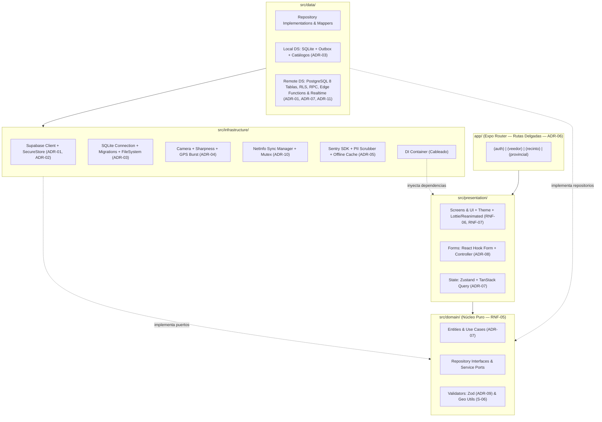
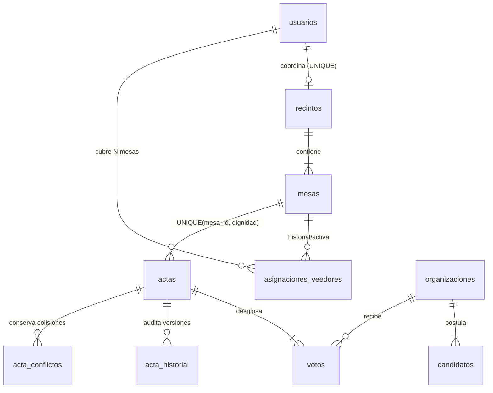
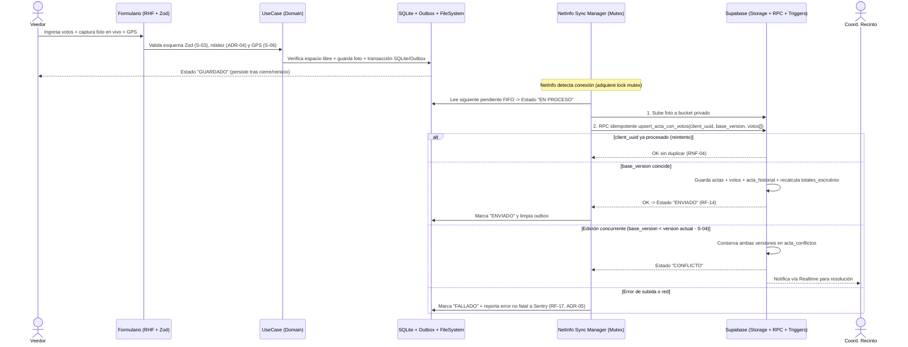

# Arquitectura de Software — Control Electoral Móvil

## 1. Propósito y Línea Base del Proyecto

Este documento define la arquitectura de software de la aplicación móvil de **Control Electoral para Organización Política**, desarrollada en React Native (Expo) y distribuida como archivo **APK instalable para Android** (**RNF-01**).

Su elaboración precede a la instalación de dependencias y codificación (**RNF-08**) y garantiza el cumplimiento estricto e íntegro de la línea base consensuada por el equipo:
- **20 Requerimientos Funcionales:** `RF-01` a `RF-20`
- **8 Requerimientos No Funcionales:** `RNF-01` a `RNF-08`
- **6 Supuestos Adoptados:** `S-01` a `S-06`
- **11 Decisiones Arquitectónicas:** `ADR-01` a `ADR-11`

---

## 2. Estilo Arquitectónico: Clean Architecture (4 Capas) + Expo Router

Para facilitar el mantenimiento, la corrección de errores y la evolución del sistema (**RNF-05**), el proyecto adopta **Clean Architecture** con separación estricta en cuatro capas dentro de `src/`, completamente desacopladas del sistema de enrutamiento basado en archivos de **Expo Router** en `app/` (**ADR-06**).

### Regla de Dependencias
Las dependencias apuntan **siempre hacia el núcleo (`src/domain/`)**:

1. **`app/` (Enrutamiento — Rutas Delgadas — ADR-06):** Contiene exclusivamente layouts, la guardia de redirección inicial y archivos de ruta mínimos que leen parámetros de navegación y delegan el renderizado a `src/presentation/screens/`. No aloja lógica de negocio, componentes reutilizables, validaciones ni acceso directo a bases de datos o SDKs.
2. **`src/presentation/` (Presentación):** Pantallas reales (`screens/`), identidad visual de la organización política y animaciones con Lottie + Reanimated (**RNF-06**), UX accesible y tolerante a errores para usuarios mayores (**RNF-07**), formularios con React Hook Form (`Controller`) (**ADR-08**), estado local/sesión/sync en Zustand y caché remota con TanStack Query (**ADR-07**). Solo interactúa con `src/domain/` mediante casos de uso.
3. **`src/domain/` (Dominio — Núcleo Puro):** Entidades del negocio, contratos de repositorios, puertos de servicios nativos, casos de uso (**ADR-07**), utilidades geográficas (Haversine) y esquemas de validación centralizados con Zod (**ADR-09**). **Cero dependencias** de React, Expo, Supabase, SQLite o UI.
4. **`src/data/` (Datos):** Implementaciones concretas de los repositorios del dominio, mappers (DTO ↔ Entidad) y *datasources* encargados de consultas relacionales en SQLite/Outbox (**ADR-03**) y consumo del modelo relacional de 8 tablas, totales precalculados, RPCs, Storage, Edge Functions y Realtime encapsulado de Supabase (**ADR-01**, **ADR-07**, **ADR-11**).
5. **`src/infrastructure/` (Infraestructura — Frameworks & Drivers):** Adaptadores de hardware, red, almacenamiento y SDKs externos (cliente Supabase + SecureStore, motor SQLite y migraciones, FileSystem con verificación de espacio libre, Expo Camera + análisis de nitidez, Expo Location con muestreo GPS, NetInfo Sync Manager con control de concurrencia, Sentry con filtrado PII y buffer offline, y contenedor de inyección de dependencias).



---

## 3. Estructura de Carpetas del Repositorio

En cumplimiento de **ADR-06** y **ADR-11**, todo el código de Clean Architecture reside fuera de `app/`, y el modelo entidad-relación junto con las políticas RLS y pruebas de aislamiento se documentan dentro del repositorio.

```text
.
├── docs/
│   ├── arquitectura.md                     # Documentación arquitectónica integral (RNF-08)
│   ├── modelo-datos-rls.md                 # Diagrama MER, restricciones y políticas RLS por rol (ADR-11)
│   └── adr/                                # ADR-01.md a ADR-11.md (línea base consensuada)
├── app/                                    # Solo rutas delgadas de Expo Router (ADR-06)
│   ├── _layout.tsx                         # Sentry, QueryClient, NetInfo y Guard de sesión/rol/clave
│   ├── index.tsx                           # Evaluación inicial y redirección
│   ├── (auth)/
│   │   ├── _layout.tsx
│   │   ├── login.tsx                       # Acceso restringido sin registro público (RF-01)
│   │   ├── primer-ingreso.tsx              # Cambio obligatorio de clave temporal (RF-02)
│   │   ├── recuperar-clave.tsx             # Solicitud de enlace solo para correos verificados (RF-04)
│   │   └── nueva-clave.tsx                 # Destino de deep link de recuperación (ADR-02)
│   ├── (veedor)/
│   │   ├── _layout.tsx
│   │   ├── index.tsx                       # Mis mesas asignadas y estado de actas (RF-14, RF-18)
│   │   ├── mesa/[mesaId].tsx               # Selección Alcaldía / Prefectura y avance (RF-09, S-02)
│   │   ├── acta-form.tsx                   # Registro/edición + cámara en vivo + GPS (RF-09 a RF-13, RF-19)
│   │   └── cola-sync.tsx                   # Detalle de cola offline y estados exactos (RF-14, RF-16)
│   ├── (recinto)/
│   │   ├── _layout.tsx
│   │   ├── index.tsx                       # Panel del recinto y alertas de conflicto (RF-18, S-04)
│   │   ├── mesas.tsx                       # Asignación múltiple y reemplazo instantáneo (RF-08, RF-20, S-05)
│   │   ├── veedores.tsx                    # Registro de veedores y sustituto express (RF-01, RF-02, RF-20)
│   │   ├── actas.tsx                       # Consulta y corrección de actas del recinto (RF-13)
│   │   └── conflictos.tsx                  # Comparación lado a lado y resolución de versiones (S-04)
│   └── (provincial)/
│       ├── _layout.tsx
│       ├── index.tsx                       # Conteo rápido (Exit Poll) en vivo y avance (RF-15, ADR-07)
│       ├── recintos.tsx                    # Consulta, creación y asignación única de coord. (RF-06, RF-07)
│       ├── coordinadores.tsx               # Gestión y creación de coord. de recinto (RF-01, RF-02)
│       └── acta-auditoria/[id].tsx         # Solo lectura: foto + desglose + mapa GPS alerta >300m (S-06, ADR-11)
├── src/
│   ├── domain/                             # CAPA 1: Dominio puro (0 dependencias externas)
│   │   ├── entities/                       # Usuario, Recinto, Mesa, AsignacionVeedor, Organizacion, Candidato, Acta, Voto, Conflicto, SyncItem
│   │   ├── repositories/                   # IAuthRepository, ITerritorioRepository, IActaRepository, IEscrutinioRepository, ISyncRepository
│   │   ├── ports/                          # ILocationPort, ISharpnessPort, IFileStoragePort, INetworkMonitorPort, ICrashMonitorPort
│   │   ├── usecases/                       # Casos de uso atómicos (auth/, territorio/, actas/, escrutinio/, sync/)
│   │   ├── validators/                     # Esquemas Zod: cedulaEcuador.ts, userSchema.ts, actaSchema.ts (ADR-09)
│   │   └── utils/                          # geoDistance.ts (Haversine y umbral 300m — S-06)
│   ├── data/                               # CAPA 2: Persistencia, mappers y repositorios
│   │   ├── datasources/
│   │   │   ├── local/                      # actaLocalDS.ts, outboxLocalDS.ts, catalogLocalDS.ts (ADR-03)
│   │   │   └── remote/                     # authRemoteDS.ts, territorioRemoteDS.ts, actaRemoteDS.ts, realtimeDS.ts
│   │   ├── mappers/                        # Mappers SQLite/Supabase <-> Entidades de Domain
│   │   └── repositories/                   # AuthRepositoryImpl, TerritorioRepositoryImpl, ActaRepositoryImpl, EscrutinioRepositoryImpl, SyncRepositoryImpl
│   ├── infrastructure/                     # CAPA 3: SDKs externos, hardware y DI
│   │   ├── supabase/                       # supabaseClient.ts, secureStoreAdapter.ts (ADR-01, ADR-02)
│   │   ├── sqlite/                         # dbConnection.ts, migrations.ts (ADR-03)
│   │   ├── storage/                        # fileSystemPhotoAdapter.ts (guardado local y validación de espacio)
│   │   ├── device/                         # gpsLocationAdapter.ts, sharpnessAnalyzer.ts (ADR-04)
│   │   ├── network/                        # netInfoSyncManager.ts (escucha NetInfo + lock mutex — ADR-10)
│   │   ├── monitoring/                     # sentryAdapter.ts (cierres nativos/JS, errores no fatales, breadcrumbs, filtro PII — ADR-05)
│   │   └── di/                             # container.ts (inyección de dependencias)
│   ├── presentation/                       # CAPA 4: Pantallas, UI, estado y formularios
│   │   ├── screens/                        # Vistas reales separadas por auth/, veedor/, recinto/, provincial/
│   │   ├── theme/                          # Paleta de la organización política y escalas accesibles (RNF-06, RNF-07)
│   │   ├── store/                          # Zustand: authStore.ts, syncStore.ts, feedbackStore.ts (ADR-07)
│   │   ├── hooks/                          # Hooks de TanStack Query, suscripción Realtime y formularios (ADR-07, ADR-08)
│   │   └── components/                     # FeedbackOverlay (Lottie + Reanimated), ConfirmSheet, ControlledInput, MapAuditView, StatusBadge
│   └── shared/                             # Constantes, tipos de error y utilidades transversales
├── assets/
│   └── lottie/                             # Animaciones JSON (loading, success, error, warning, syncing)
└── supabase/
    ├── migrations/                         # Esquema 8 tablas, triggers de totales precalculados, RPC versionada y RLS (ADR-11)
    ├── seed.sql                            # Provincia/cantón, recintos, mesas, 5 organizaciones, candidatos y Coord. Provincial (RF-05, S-01)
    ├── tests/
    │   └── rls_verification.sql            # Pruebas de aislamiento por rol (demuestra que un veedor no ve otra mesa — ADR-11)
    └── functions/
        └── create-managed-user/            # Edge Function para creación jerárquica de usuarios vía API sin cerrar sesión (ADR-01, ADR-02)
```

---

## 4. Matriz de Trazabilidad (ADRs ↔ Capas ↔ Requerimientos)

| ADR | Decisión Consensuada | Capas Responsables | Requerimientos / Supuestos |
| :--- | :--- | :--- | :--- |
| **ADR-01** | **Supabase Auth + API servidor + RLS + flag de clave temporal** | `infrastructure/supabase`, `data/remote`, Backend | RF-01, RF-02, RF-03, RF-04, RNF-02, S-01 |
| **ADR-02** | **Supabase + SMTP personalizado** (enlaces de uso único con expiración, dominio propio, deep links) | `infrastructure/supabase`, `app/(auth)`, Backend | RF-01, RF-03, RF-04, RNF-02 |
| **ADR-03** | **SQLite (`expo-sqlite`) + Outbox + UUID por acta + foto en disco local + control de versiones** | `infrastructure/sqlite`, `infrastructure/storage`, `data/local` | RF-14, RF-16, RNF-03, RNF-04, S-04 |
| **ADR-04** | **`expo-camera` en vivo + medición de nitidez + `expo-location` con múltiples lecturas GPS** | `domain/ports`, `infrastructure/device`, `presentation/` | RF-11, RF-12, RF-15, S-06 |
| **ADR-05** | **Sentry React Native SDK** (cierres nativos/JS, errores no fatales, breadcrumbs, buffer offline y filtrado PII) | `domain/ports`, `infrastructure/monitoring`, `app/_layout` | RF-17, RNF-02, RNF-03 |
| **ADR-06** | **Expo Router** con grupos por rol y guardia de redirección (sesión, rol, primer cambio de clave) | `app/` | RF-01, RF-02, RF-18, RNF-05, RNF-07 |
| **ADR-07** | **Zustand + TanStack Query + Supabase Realtime** encapsulado tras repositorios | `presentation/store`, `presentation/hooks`, `data/repositories` | RF-14, RF-15, RF-16, RNF-05 |
| **ADR-08** | **React Hook Form** (`Controller`) para formularios de usuarios, territorio, reemplazos y actas | `presentation/components`, `presentation/hooks` | RF-02, RF-06, RF-08, RF-09, RF-13, RF-20, RNF-04, RNF-07, S-03 |
| **ADR-09** | **Zod** centralizado para cédula ecuatoriana, teléfono, correos y coherencia matemática de actas | `domain/validators` | RF-02, RF-10, RF-12, RF-19, RNF-02, S-02, S-03 |
| **ADR-10** | **`@react-native-community/netinfo` + cola transaccional SQLite + UUID idempotente + lock** | `infrastructure/network`, `data/local`, `domain/usecases/sync` | RF-14, RF-16, RNF-03, RNF-04, S-04 |
| **ADR-11** | **PostgreSQL relacional (8 tablas) + `UNIQUE(mesa, dignidad)` + RLS estricto + totales precalculados** | `data/remote`, `supabase/migrations`, `docs/modelo-datos-rls.md` | RF-06, RF-07, RF-08, RF-18, RF-19, RF-20, S-02, S-03, S-05 |

---

## 5. Modelo de Datos Relacional y Totales Precalculados (ADR-11)

En cumplimiento estricto de **ADR-11**, la base de datos remota en PostgreSQL (Supabase) se normaliza en las **8 tablas principales** acordadas, más **3 tablas de soporte** para historial de auditoría, resolución de conflictos y totales precalculados (documentadas a detalle en `docs/modelo-datos-rls.md`):



### Reglas de integridad en base de datos
- **Tablas principales (ADR-11):** `usuarios`, `recintos`, `mesas`, `asignaciones_veedores`, `actas`, `organizaciones`, `candidatos` y `votos`.
- **Unicidad territorial y de escrutinio:**
  - `UNIQUE(coordinador_id)` en `recintos` garantiza que cada recinto tenga un único coordinador responsable y bloquea la asignación simultánea de dos coordinadores (**RF-07**).
  - Índice único parcial `UNIQUE(mesa_id) WHERE activa = true` en `asignaciones_veedores` asegura un único veedor activo por mesa, permitiendo a un mismo veedor cubrir múltiples mesas sin límite (**RF-08**) y conservando el historial de auditoría al revocar accesos por reemplazo (**RF-20**, **S-05**).
  - `UNIQUE(mesa_id, dignidad)` en `actas` garantiza un máximo de dos actas válidas por mesa (`ALCALDIA` y `PREFECTURA`) (**S-02**, **ADR-11**).
  - `UNIQUE(client_uuid)` en `actas` garantiza idempotencia ante reintentos de red (**RNF-04**, **ADR-03**, **ADR-10**).
- **Validación matemática en servidor (RF-19, S-03, ADR-11):** Restricciones `CHECK` impiden valores negativos y la RPC transaccional `upsert_acta_con_votos` verifica antes de confirmar que ningún candidato/organización supere `total_sufragantes` y que `SUM(votos.cantidad) + votos_blancos + votos_nulos = total_sufragantes`.
- **Totales precalculados (consecuencia ADR-11):** La tabla resumen `totales_escrutinio` (agrupada por `recinto_id`, `dignidad` y `organizacion_id`) y los contadores de avance de mesas se recalculan automáticamente mediante triggers transaccionales cada vez que se inserta o corrige un acta/votos, garantizando lecturas instantáneas en el conteo rápido sin inconsistencias al editar actas.

---

## 6. Diseño de los Flujos Críticos

### 6.1 Autenticación Jerárquica, Verificación SMTP y Guardia de Rutas (ADR-01, ADR-02, ADR-06)
- **Raíz precargada (S-01):** El único Coordinador Provincial se precarga mediante `seed.sql` con correo verificado y rol `PROVINCIAL`. El registro público permanece deshabilitado en Supabase Auth.
- **Creación por terceros en servidor (RF-01, RF-02, RF-20):** El Coordinador Provincial crea Coordinadores de Recinto y estos crean Veedores (incluidos veedores sustitutos externos) mediante la Edge Function `create-managed-user`. La función valida cédula ecuatoriana, nombres, apellidos, teléfono y correo, crea la cuenta sin interrumpir la sesión del coordinador y dispara el **enlace de confirmación** a través del **SMTP personalizado** (**RF-03**; credenciales SMTP almacenadas únicamente en Supabase, **RNF-02**).
- **Verificación y recuperación (RF-03, RF-04):** Los enlaces de confirmación y recuperación son de uso único y con tiempo de expiración. La recuperación solo se habilita para correos previamente verificados y redirige a la app usando el esquema de *deep link* configurado de forma idéntica en desarrollo y en el APK (`controlelectoral://`).
- **Redirección inicial en `app/_layout.tsx` (ADR-06):** Evalúa secuencialmente:
  1. `¿Existe sesión válida con correo verificado?` → Si no, redirige a `/(auth)/login`.
  2. `¿must_change_password === true en metadatos/usuario?` → Si sí, obliga a pasar por `/(auth)/primer-ingreso` (**RF-02**).
  3. `¿Rol activo?` → Redirige al grupo exclusivo `/(provincial)`, `/(recinto)` o `/(veedor)`.

### 6.2 Persistencia Offline-First, Sincronización Automática y Conflictos (ADR-03, ADR-10, S-04)
- **Fuente de verdad local:** Toda creación o edición de acta y sus votos por organización se persiste en una transacción de `expo-sqlite` (`local_actas`, `local_votos` y `sync_outbox`) con un `client_uuid` único y `base_version`, sobreviviendo a cierres de la app o reinicios del dispositivo (**RNF-04**).
- **Gestión segura de fotografías locales (consecuencia ADR-03):** `fileSystemPhotoAdapter.ts` verifica previamente el espacio libre en disco antes de guardar la fotografía localmente y notifica al usuario si el almacenamiento es insuficiente. Ni el archivo ni el registro local se borran hasta que el servidor confirme la recepción.
- **Motor NetInfo con bloqueo de concurrencia (ADR-10):** `netInfoSyncManager.ts` escucha cambios de conectividad, adquiere un *mutex* (`isSyncing`) para evitar que dos eventos simultáneos procesen el mismo elemento de la cola, recorre `sync_outbox` en orden FIFO y actualiza el estado visible en tiempo real: **`GUARDADO`** (offline local — RNF-06, ADR-10) → **`EN PROCESO`** → **`ENVIADO`** (sincronizado — RF-14) / **`FALLADO`** / **`CONFLICTO`**.
- **Idempotencia y resolución de conflictos (RNF-04, S-04):** La RPC `upsert_acta_con_votos` valida `client_uuid` (evitando duplicados en reintentos) y compara `base_version` contra la versión actual en servidor. Si dos dispositivos modificaron la misma acta antes de sincronizarse, el servidor conserva ambas versiones en `acta_conflictos` y notifica vía Realtime al Coordinador de Recinto para que decida cuál prevalece.



### 6.3 Validación Matemática, Captura en Vivo y Geolocalización (ADR-04, ADR-08, ADR-09, S-03, S-06)
- **Bloqueo estricto de inconsistencias (RF-10, RF-19, S-03):** `src/domain/validators/actaSchema.ts` bloquea cualquier guardado o edición si existen valores negativos, si alguna de las 5 organizaciones supera `total_sufragantes` o si `suma(votos_organizaciones) + blancos + nulos !== total_sufragantes`.
- **Fotografía en vivo con validación de nitidez (RF-11, ADR-04):** La captura se realiza exclusivamente mediante `expo-camera` (sin selector de galería). Tras el disparo, `sharpnessAnalyzer.ts` mide la nitidez (calibrada con fotografías reales de actas); si la imagen resulta borrosa o ilegible advierte al usuario y bloquea la continuación. Cuando supera el umbral, el veedor revisa la vista previa antes de confirmar el registro.
- **Geolocalización de mejor precisión (RF-12, S-06):** Al momento del disparo, `gpsLocationAdapter.ts` ejecuta múltiples lecturas con `expo-location` y conserva la coordenada con menor margen de error (`accuracy`). Sin permiso o GPS activo no se permite guardar, aunque no se aplica geocerca bloqueante; en la vista de auditoría del coordinador, `geoDistance.ts` (Haversine) muestra el punto en el mapa junto al recinto con una **alerta visual si supera los 300 metros**.

### 6.4 Manejo de Estado y Conteo Rápido (Exit Poll) en Tiempo Real (ADR-07, RF-15, S-02)
- **Zustand (`src/presentation/store/`):** Gestiona estado síncrono de sesión, perfil/rol, conectividad (`isOnline`), progreso de la cola offline (`isSyncing`, `pendingCount`) y el estado del `FeedbackOverlay`.
- **TanStack Query (`src/presentation/hooks/`):** Gestiona consultas y mutaciones remotas conectadas a los casos de uso de `src/domain/`, controlando carga, caché y errores sin re-renders innecesarios en celulares de gama media/baja.
- **Supabase Realtime encapsulado:** `realtimeDS.ts` y `EscrutinioRepositoryImpl.ts` encapsulan las suscripciones detrás de contratos del dominio y cierran las conexiones al cerrar sesión. Cada nueva acta o modificación recibida invalida selectivamente las queries de conteo acumulado (Alcaldía y Prefectura, por recinto y total) y avance de mesas (**completa** = Alcaldía + Prefectura recibidas; **parcial** = solo una recibida, **S-02**).

---

## 7. Seguridad, Aislamiento RLS y Monitoreo

### 7.1 Políticas Row Level Security y Revocación Inmediata (RF-18, RNF-02, S-05, ADR-11)
El aislamiento opera tanto en navegación (**ADR-06**) como en base de datos mediante **Row Level Security (RLS)** en todas las tablas, verificado antes de la defensa con `supabase/tests/rls_verification.sql`:
- **Veedor:** Acceso de consulta y edición exclusivamente sobre mesas con asignación activa en `asignaciones_veedores` (`veedor_id = auth.uid() AND activa = true`) y sus respectivas `actas` y `votos`. Al ser reemplazado por ausencia (**RF-20**), el cambio a `activa = false` revoca su acceso al instante en RLS, mientras las actas ya registradas se conservan intactas junto con su `acta_historial` (**S-05**).
- **Coordinador de Recinto:** Acceso de consulta y edición exclusivamente sobre mesas, asignaciones, veedores, actas, votos y conflictos de su recinto (`recintos.coordinador_id = auth.uid()`).
- **Coordinador Provincial:** Acceso de **solo lectura** sobre actas, votos, historial y totales precalculados de toda su jurisdicción (**no puede modificar actas**, **ADR-11**). Puede consultar/crear recintos, asignar un único coordinador por recinto (**RF-06**, **RF-07**) y crear coordinadores mediante Edge Function (**RF-01**).

### 7.2 Protección de Datos y Observabilidad con Sentry (RF-17, RNF-02, RNF-03, ADR-05)
- Los tokens de autenticación se cifran en dispositivo mediante `expo-secure-store`.
- Las evidencias fotográficas se almacenan en un bucket privado de Supabase Storage con acceso por URLs firmadas.
- **Sentry (`sentryAdapter.ts`)** captura cierres nativos (en Development Build / APK), excepciones de JavaScript y **errores no fatales que impiden culminar una tarea** (por ejemplo, fallos al subir una foto o sincronizar), registrando modelo de dispositivo, versión de Android, versión de la app y breadcrumbs de pantallas previas, con almacenamiento offline automático para su envío al recuperar la red.
- El hook `beforeSend` sanitiza todos los eventos salientes eliminando cualquier dato sensible (**cédulas, nombres, teléfonos y correos electrónicos**) antes de su transmisión (**ADR-05**, **RNF-02**).

---

## 8. Lineamientos de Diseño Visual y Accesibilidad (RNF-06, RNF-07)

- **Identidad de la organización política:** Todos los colores, superficies, encabezados, badges de dignidad y gráficos del conteo rápido se centralizan en `src/presentation/theme/` respetando la paleta de la organización política elegida.
- **Retroalimentación visual sin modales genéricos:** Se prohíbe el uso de `Alert.alert` nativos. Los estados `guardado`, `en proceso`, `enviado`, `fallado`, `conflicto` y las validaciones de formularios utilizan componentes personalizados con **Lottie** y **React Native Reanimated** (`FeedbackOverlay`, `ConfirmSheet` y banners de estado de conectividad).
- **Experiencia tolerante a errores (RNF-07):** Botones con altura mínima táctil de `52px`, tipografía de alto contraste, teclado numérico dedicado para ingreso de votos, indicador visual en tiempo real del cuadre de sufragantes y bloqueo de botones durante el procesamiento para impedir envíos duplicados (**ADR-08**).

---

## 9. Estrategia de Compilación y Verificación (RNF-01, ADR-11)

- **Empaquetado Android:** Generación del binario `.apk` mediante **EAS Build** (`eas.json`, perfil `preview` con `buildType: "apk"`).
- **Paridad de Deep Links:** El esquema URL registrado en `app.json` (`controlelectoral://`) coincide con las *Redirect URLs* de Supabase Auth para garantizar la verificación de correo y recuperación de clave en el APK instalado (**ADR-02**).
- **Pruebas obligatorias previas a la defensa:**
  1. Verificación RLS con usuarios de los 3 roles y datos de prueba que demuestren que un veedor no puede ver ni modificar otra mesa y que el coordinador provincial no puede editar actas (**ADR-11**).
  2. Calibración del umbral de nitidez con fotografías reales de actas del CNE (**ADR-04**).
  3. Persistencia de SQLite tras cierre/reinicio y sincronización automática sin duplicados al desactivar Modo Avión (**ADR-03**, **ADR-10**).
  4. Captura real de cierres nativos y errores no fatales en Sentry desde el APK instalado verificando ausencia de PII (**ADR-05**).
  5. Recálculo exacto de `totales_escrutinio` y actualización en vivo del conteo rápido al registrar y corregir actas (**ADR-07**, **ADR-11**).